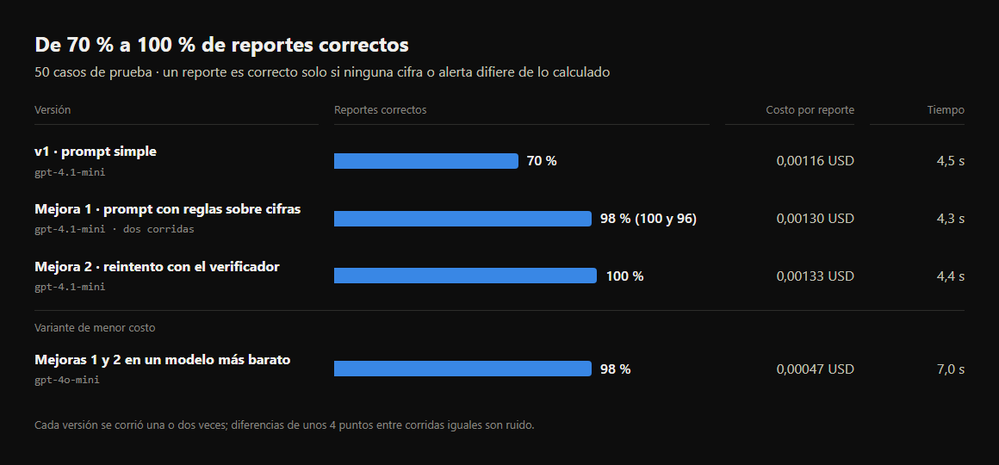
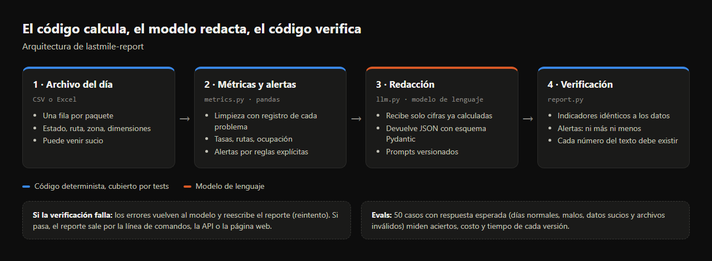
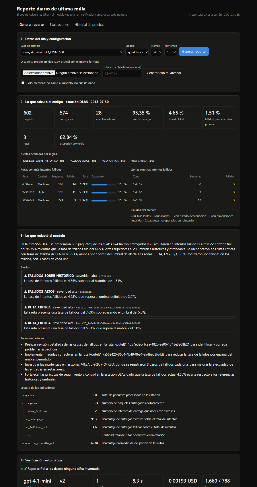
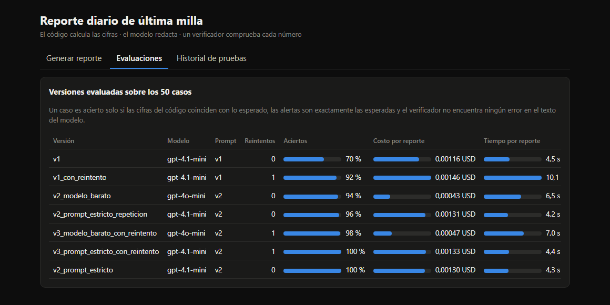

<div align="center">

# 🚚 lastmile-report

### Reporte diario de última milla con IA generativa

**El código calcula · el modelo redacta · un verificador comprueba cada número**


</div>



## 📌 El problema

En una operación logística, el reporte diario de entregas, intentos fallidos y cumplimiento se arma a mano desde Excel. Un modelo de lenguaje puede redactarlo en segundos, pero no es confiable haciendo cuentas: redondea, inventa metas y calcula porcentajes por su cuenta.

Este proyecto resuelve eso separando responsabilidades:

| Quién | Qué hace | Cómo se comprueba |
|---|---|---|
| **Código (pandas)** | Limpia el archivo, calcula las métricas y decide las alertas con reglas explícitas | 71 tests y una implementación independiente de lo esperado |
| **Modelo de lenguaje** | Redacta resumen, alertas y recomendaciones a partir de cifras ya calculadas | Salida obligada a un esquema Pydantic |
| **Verificador (código)** | Revisa que cada número del reporte exista en las métricas | Si falla, devuelve los errores al modelo para que corrija |

## 🏗️ Arquitectura



| Archivo | Responsabilidad |
|---|---|
| [`metrics.py`](src/lastmile_report/metrics.py) | Limpieza, métricas y alertas. No usa ningún modelo |
| [`report.py`](src/lastmile_report/report.py) | Esquema del reporte y verificador de cifras |
| [`llm.py`](src/lastmile_report/llm.py) | Única parte que llama al modelo: prompts versionados y reintento |
| [`evals.py`](src/lastmile_report/evals.py) | Corre los 50 casos y mide aciertos, costo y tiempo |
| [`comparar.py`](src/lastmile_report/comparar.py) | Compara varios modelos sobre los mismos archivos, en vivo |
| [`api.py`](src/lastmile_report/api.py) · [`web.py`](src/lastmile_report/web.py) | API con FastAPI y página web local |
| [`cli.py`](src/lastmile_report/cli.py) | Línea de comandos |
| [`ingest.py`](src/lastmile_report/ingest.py) | Convierte el dataset crudo en un archivo por estación y día |
| [`evals/construir_casos.py`](evals/construir_casos.py) | Genera los 50 casos y su respuesta esperada |

## 🖥️ La aplicación

Una página web local para generar reportes, cambiar de modelo y de prompt, y comparar el resultado, el costo y el tiempo de cada prueba.



La pestaña de evaluaciones muestra todas las versiones medidas sobre los 50 casos:



## 🚀 Cómo correrlo

Requiere [uv](https://docs.astral.sh/uv/). Python 3.12 se instala solo.

```bash
git clone https://github.com/MiguelData2030/lastmile-report.git
cd lastmile-report
uv sync
cp .env.example .env        # y pega tu OPENAI_API_KEY dentro
```

| Para | Comando |
|---|---|
| Abrir la página web en `http://localhost:8000` | `uv run lastmile-api` |
| Generar un reporte por línea de comandos | `uv run lastmile-report evals/casos/archivos/caso_21.csv` |
| Ver solo las métricas, sin modelo y gratis | `uv run lastmile-report evals/casos/archivos/caso_21.csv --solo-metricas` |
| Evaluar los 50 casos | `uv run lastmile-eval --prompt v2 --reintentos 1 --etiqueta mi_prueba` |
| Comparar modelos en vivo | `uv run lastmile-comparar evals/casos/archivos/caso_21.csv evals/casos/archivos/caso_01.csv` |
| Correr los tests | `uv run pytest` |

La página acepta enlaces directos, por ejemplo `http://localhost:8000/?caso=caso_34&auto=1`.

## 📊 Resultados

Los 50 casos se reparten así: 20 días normales, 15 días malos, 13 con datos sucios inyectados y 2 archivos inválidos. Un caso es acierto solo si se cumplen tres cosas: las cifras del código coinciden con lo esperado, las alertas son exactamente las esperadas y el verificador no encuentra ningún error en el texto del modelo.

| Versión | Modelo | Aciertos | Costo por reporte | Tiempo por reporte |
|---|---|---|---|---|
| v1 · prompt simple (línea base) | gpt-4.1-mini | 70 % | 0,00116 USD | 4,5 s |
| Mejora 1 · prompt con reglas sobre cifras | gpt-4.1-mini | 100 % y 96 % (dos corridas) | 0,00130 USD | 4,3 s |
| Mejora 2 · mejora 1 + reintento con el verificador | gpt-4.1-mini | 100 % | 0,00133 USD | 4,4 s |

<details>
<summary><b>Mediciones adicionales</b></summary>

| Variante | Modelo | Aciertos | Costo por reporte | Tiempo por reporte |
|---|---|---|---|---|
| Reintento solo, sobre el prompt v1 | gpt-4.1-mini | 92 % | 0,00146 USD | 10,1 s |
| Prompt v2 en un modelo más barato | gpt-4o-mini | 94 % | 0,00043 USD | 6,5 s |
| Prompt v2 + reintento en el modelo más barato | gpt-4o-mini | 98 % | 0,00047 USD | 7,0 s |

</details>

### Qué aprendí de los números

- **El código nunca falló.** En todas las versiones calculó bien el 100 % de los casos; todos los errores vinieron del texto del modelo.
- **Los fallos de v1 eran de tres tipos:** metas inventadas ("ocupación cercana al 60-70 %"), redondeos ("superior al 99 %") y cuentas propias ("3.08 puntos superior al histórico"). El prompt v2 prohíbe las tres.
- **El reintento solo sube v1 de 70 % a 92 %**, pero duplica el tiempo. Con el prompt v2 casi nunca se activa (1 de 48 reportes), así que queda como red de seguridad barata.
- **Más caro no es mejor.** En una prueba inicial, un modelo 16 veces más caro inventó más cifras porque escribe más análisis propio.
- **Un modelo más barato llega a 98 %** con las dos mejoras, a un tercio del costo.

### Limitaciones de la medición

- Cada versión se corrió una o dos veces. Dos corridas idénticas dieron 100 % y 96 %, así que diferencias de ese tamaño no son concluyentes.
- El prompt v2 se escribió viendo los fallos de v1 en estos mismos 50 casos; falta validarlo en días que no haya visto.
- El verificador mide fidelidad de cifras y alertas, no la calidad de la redacción ni la utilidad de las recomendaciones.
- Los precios por token están escritos a mano en `llm.py` y deben verificarse contra la página de precios del proveedor.

Los resultados completos de cada versión, con el reporte de cada caso, están en [`evals/resultados/`](evals/resultados).

## 🧪 Cómo se construyeron los evals

1. Se parte de 521 días reales (una estación, un día) y se eligen 50 con una semilla fija.
2. A 13 de ellos se les inyecta suciedad conocida: encabezados descuidados, estados mal escritos, coma decimal, filas duplicadas, estados desconocidos, dimensiones basura y formato Excel.
3. La respuesta esperada se calcula con Python puro, sin usar el código del proyecto. Son dos implementaciones independientes que deben coincidir.
4. La parte de código de los 50 casos corre en cada `pytest`, sin llamar al modelo.

Un hallazgo de los datos reales: un paquete que aparece dos veces en el día no es un duplicado, es un intento fallido seguido de una entrega exitosa. El sistema lo cuenta con su mejor estado final y lo informa como "recuperado en reintento".

## 📦 Datos

Los datos provienen del [Amazon Last Mile Routing Research Challenge 2021](https://registry.opendata.aws/amazon-last-mile-challenges/) (Amazon.com, Inc., licencia [CC BY-NC 4.0](https://creativecommons.org/licenses/by-nc/4.0/)): 6.112 rutas y 1.457.175 paquetes de 17 estaciones en Estados Unidos, entre julio y agosto de 2018.

- Son datos públicos y anonimizados: no contienen nombres de clientes ni direcciones.
- Los archivos de `evals/casos/archivos/` son subconjuntos de ese dataset, algunos modificados a propósito para simular datos sucios. Uso no comercial.
- El dataset no incluye devoluciones, causa del intento fallido ni hora real de entrega, así que el reporte no cubre esos temas.

Para reconstruir los archivos diarios completos, descarga `route_data.json` y `package_data.json` del bucket público a `data/raw/` y ejecuta `uv run python -m lastmile_report.ingest`.

## 🗺️ Próximos pasos

- Validar con una persona de operación que lo use cada semana y recoger su opinión por escrito.
- Probar el prompt v2 en días fuera de los 50 casos.
- Agregar un agente analista que compare contra el histórico y un tablero con la evolución por estación.
