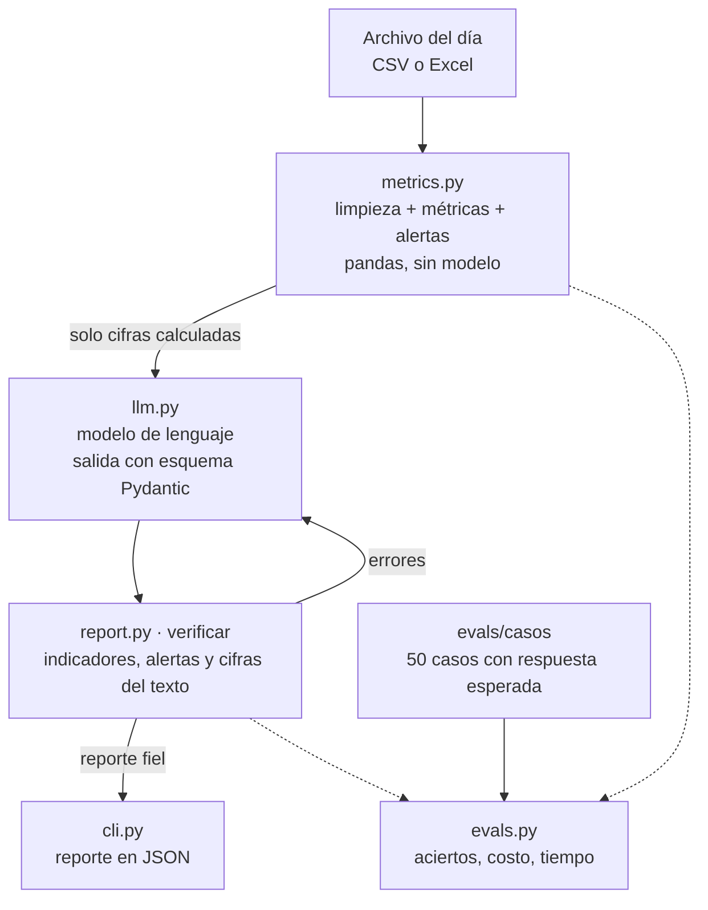

# lastmile-report

Asistente que lee el archivo diario de una estación de última milla y redacta el reporte del día: resumen, indicadores, alertas y recomendaciones.

## El problema

En una operación logística el reporte diario (entregas, intentos fallidos, cumplimiento) se arma a mano desde Excel. Un modelo de lenguaje puede redactarlo, pero no es confiable haciendo cuentas. Este proyecto separa las dos cosas:

- **El código calcula.** pandas limpia el archivo, calcula las métricas y decide las alertas con reglas explícitas.
- **El modelo redacta.** Recibe solo las cifras ya calculadas y devuelve un JSON validado.
- **El código verifica.** Cada número del reporte debe existir en las métricas; si no, el reporte se rechaza o se corrige.

## Arquitectura



| Archivo | Qué hace |
|---|---|
| `src/lastmile_report/ingest.py` | Convierte el dataset crudo en un archivo por estación y día |
| `src/lastmile_report/metrics.py` | Limpieza, métricas y alertas. No usa ningún modelo |
| `src/lastmile_report/report.py` | Esquema del reporte y verificador de cifras |
| `src/lastmile_report/llm.py` | Única parte que llama al modelo: prompts versionados y reintento |
| `src/lastmile_report/cli.py` | Línea de comandos para generar un reporte |
| `src/lastmile_report/evals.py` | Corre los 50 casos y mide aciertos, costo y tiempo |
| `src/lastmile_report/comparar.py` | Compara varios modelos sobre los mismos archivos |
| `evals/construir_casos.py` | Genera los 50 casos y su respuesta esperada con una implementación independiente |

## Cómo correrlo

Requiere [uv](https://docs.astral.sh/uv/). Python 3.12 se instala solo.

```bash
uv sync
cp .env.example .env        # y pega tu OPENAI_API_KEY dentro

# Reporte de un archivo (hay 50 de ejemplo en evals/casos/archivos)
uv run lastmile-report evals/casos/archivos/caso_21.csv
uv run lastmile-report evals/casos/archivos/caso_21.csv --solo-metricas   # sin modelo

# Evaluación
uv run lastmile-eval --prompt v2 --reintentos 1 --etiqueta mi_prueba
uv run lastmile-eval --sin-modelo      # solo la parte de código, gratis

# Tests y estilo
uv run pytest
uv run ruff check .
```

El histórico para la alerta "fallidos sobre el histórico" se toma de los días anteriores de la misma estación que estén en la misma carpeta, con nombre `<estacion>_<fecha>.csv`.

## Resultados

50 casos: 20 días normales, 15 días malos, 13 con datos sucios inyectados y 2 archivos inválidos. Un caso es acierto solo si las cifras del código coinciden con lo esperado, las alertas son exactamente las esperadas y el verificador no encuentra ningún error en el texto del modelo.

| Versión | Modelo | Aciertos | Costo por reporte | Tiempo por reporte |
|---|---|---|---|---|
| v1 · prompt simple (línea base) | gpt-4.1-mini | 70 % | 0,00116 USD | 4,5 s |
| Mejora 1 · prompt con reglas sobre cifras (v2) | gpt-4.1-mini | 100 % y 96 % (dos corridas) | 0,00130 USD | 4,3 s |
| Mejora 2 · v2 + reintento con los errores del verificador | gpt-4.1-mini | 100 % | 0,00133 USD | 4,4 s |

Mediciones adicionales:

| Variante | Modelo | Aciertos | Costo por reporte | Tiempo por reporte |
|---|---|---|---|---|
| Reintento solo, sobre el prompt v1 | gpt-4.1-mini | 92 % | 0,00146 USD | 10,1 s |
| Prompt v2 en un modelo más barato | gpt-4o-mini | 94 % | 0,00043 USD | 6,5 s |
| Prompt v2 + reintento en el modelo más barato | gpt-4o-mini | 98 % | 0,00047 USD | 7,0 s |

Lectura de los resultados:

- En todas las versiones el código calculó bien el 100 % de los casos. Todos los fallos son del texto del modelo.
- En v1 el modelo inventaba metas ("ocupación cercana al 60-70 %"), redondeaba ("superior al 99 %") y hacía cuentas ("3.08 puntos superior"). El prompt v2 prohíbe esas tres cosas.
- El reintento por sí solo sube v1 de 70 % a 92 %, pero duplica el tiempo. Con el prompt v2 casi nunca se activa (1 de 48 reportes), así que funciona como red de seguridad barata.
- `gpt-4o-mini` cuesta cerca de un tercio y llega a 98 % con reintento.

Limitaciones de la medición:

- Cada versión se corrió una o dos veces. Entre dos corridas iguales de v2 hubo 4 puntos de diferencia, así que diferencias de ese tamaño no son concluyentes.
- El prompt v2 se escribió después de ver los fallos de v1 en estos mismos 50 casos; falta validarlo en días que no haya visto.
- El verificador mide fidelidad de cifras y alertas, no la calidad de la redacción ni la utilidad de las recomendaciones.
- Los precios por token están escritos a mano en `llm.py` y deben verificarse contra la página de precios del proveedor.

Los resultados completos de cada versión, con el reporte de cada caso, están en `evals/resultados/`.

## Datos

Los datos provienen del [Amazon Last Mile Routing Research Challenge 2021](https://registry.opendata.aws/amazon-last-mile-challenges/) (Amazon.com, Inc., licencia [CC BY-NC 4.0](https://creativecommons.org/licenses/by-nc/4.0/)). Son datos públicos y anonimizados: no contienen nombres de clientes ni direcciones. Los archivos de `evals/casos/archivos/` son subconjuntos de ese dataset, algunos modificados a propósito para simular datos sucios. Uso no comercial.

Para reconstruir los archivos diarios completos, descarga `route_data.json` y `package_data.json` del bucket público a `data/raw/` y ejecuta `uv run python -m lastmile_report.ingest`.

El dataset no incluye devoluciones, causa del intento fallido ni hora real de entrega, así que el reporte no cubre esos temas.

## Pendiente

- Una persona de la operación usándolo cada semana, con su opinión por escrito.
- API con FastAPI.
